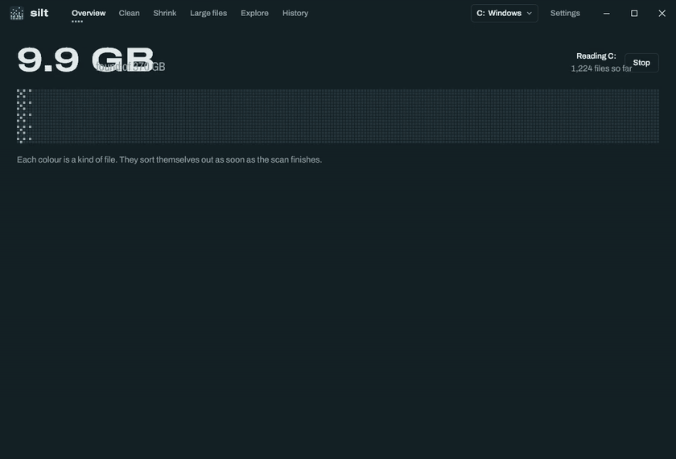

<p align="center"></p>

<p align="center">See what fills your Windows drive, and get the space back without deleting what you use.</p>

<p align="center"><a href="README.pt-BR.md">Português</a></p>

<p align="center"></p>

Silt reads the NTFS Master File Table to scan a drive in a second or two, sorts every byte into
categories, and offers four ways to get space back, from least to most destructive:

| Action | What it does | Undo |
|---|---|---|
| **Shrink** | Compresses folders with Windows' own transparent compression (the one `compact /exe` uses). Files open exactly as before; they just take less space. | Restore, any time |
| **Clean** | Empties caches that rebuild themselves (browsers, GPU shaders, package managers, Windows Update downloads), after showing what and how much. | The cache comes back on its own |
| **Trash** | Sends any file or folder you pick to the Recycle Bin. | The Recycle Bin |
| **Empty Recycle Bin** | Empties it, after showing how many items and how much. | None |

Every analyzer ends at "this is big, delete it". Silt also answers what to do when what's left is
stuff you use: the Overview shows how much you can get back in total, and how much of it
**without deleting anything**.

<p align="center"></p>

## Install

- **Installer:** `Silt-Setup-<version>.exe` from [Releases](https://github.com/bps2414/silt/releases).
  Installs for your user only, no administrator needed to install.
- **Portable:** `Silt-<version>-portable.zip`, unzip anywhere and run `silt.exe`.
- **winget** (once the package is accepted): `winget install bps2414.Silt`

Windows 10 or 11, x64. Silt asks for administrator when it opens, to read the drive's index; say
no and it still works, by opening every folder instead (slower, and a few folders stay closed to
it). Settings → "Ask for administrator" turns the question off.

## Is it safe?

Silt changes your files only when you press a button and confirm. Here is exactly what each
action does.

**Clean deletes the contents of these folders, and nothing else:**

| Group | Caches |
|---|---|
| Windows | Temporary files (`%TEMP%`), Windows temporary files (`%WINDIR%\Temp`), crash dumps and error reports, thumbnail cache, Delivery Optimization cache, Windows Update downloads* |
| Browsers | Cache folders of Chrome, Edge, Brave and Firefox (the cache only: never history, passwords, cookies or bookmarks) |
| GPU | NVIDIA*, AMD*, Intel* and DirectX* shader caches |
| Developer | npm, Yarn, Bun, uv, pip, Cargo registry, Gradle, NuGet HTTP, Go build, Electron/node-gyp and VS Code caches; pnpm store*, NuGet packages*, Go modules*, Maven repository*, Playwright browsers*, Hugging Face models* |

\* marked "Check first" and not selected by default: it comes back, but only after a download or
a slower first run (a game rebuilding shaders, a package manager downloading again).

The rules are plain TOML in [`rules/`](rules), one file per group. Each points at a folder
through an environment variable first (so relocated caches are found), then at the usual place.

**Clean never:**

- deletes the folder itself, only what is inside;
- follows a junction or symbolic link, or deletes one;
- deletes a file another program has open (it is skipped and counted);
- touches a drive root, `Users` or any profile folder, your Documents, Desktop, Downloads,
  Pictures, Videos, Music or OneDrive, `Windows`, `System32`, `SysWOW64`, `WinSxS`,
  `Program Files`, `Program Files (x86)` or `ProgramData`, nor any folder that contains one of
  them. These checks live in the code, not in the rules, so a bad rule can't get past them.

The "freed" figure after a Clean is measured on disk afterwards, not estimated.

**Shrink deletes nothing.** It asks Windows to store files compressed (WOF, the same thing
`compact /c /exe` does). Programs read them as before. It skips video, images, audio, archives,
game packages, databases, disk images, files under 4 KB, encrypted, cloud and already-compressed
files, the `Windows` folder and anti-cheat folders (the full list is
[`rules/shrink-exclude.toml`](rules/shrink-exclude.toml)). It keeps free space in reserve and
refuses to start without it. Restore undoes it, from the Shrink screen or from History.

**Trash** moves what you pick to the Recycle Bin, where you can get it back. System files and
the protected folders above never get the button. There is no "delete forever" for your own
files: the only way out of the Recycle Bin is **Empty Recycle Bin**, which asks first.

Every action is written to `%LOCALAPPDATA%\Silt\journal.jsonl`, shown in History. Silt sends
nothing over the network.

## Measured

**Scan** (MFT, administrator), on the author's machine:

| Drive | Entries | Time | Peak memory | Scanned bytes vs. used space |
|---|---|---|---|---|
| C: (151 GB used) | 790 k | 1.2 s | 151 MB | 99.98 % (34 MB of file system metadata) |
| D: (177 GB used) | 1.17 M | 8.9 s | 208 MB | 99.99 % |

The window on the same C: shows the categories 1.5 s after it opens, and the Shrink estimate for
all 72 candidate folders follows about 1.3 s later. A made-up drive with 2 million files peaks
at 280 MB. When nothing moves, the window draws nothing.

**Shrink** (XPRESS8K, the default), estimate first, then compressed, checked, and restored. Every
file read back byte for byte identical after compressing and after restoring.

| Folder | Files | Size | Estimate | Saved | Estimate error |
|---|---|---|---|---|---|
| `node_modules` of a Vite + React game | 3,231 | 359 MB | 114 to 143 MB | 128 MB (36 %) | 0 % |
| Rust 1.99.1 toolchain | 132 | 627 MB | 329 to 398 MB | 352 MB (56 %) | 3 % |
| An Xbox PC game | 324 | 5.1 GB | 2.3 to 3.0 GB | 2.9 GB (56 %) | 8 % |
| Git for Windows | 3,343 | 396 MB | 177 to 207 MB | 196 MB (50 %) | 2 % |
| Screen recordings (MP4) | 0 | 0 B | nothing to gain | 0 B | |

Video, images, audio and archives are already compressed, so Shrink leaves them alone.

## The CLI

`silt-cli` does everything the window does, as text or JSON:

```
cargo build --release -p silt-cli
target\release\silt-cli report C:          # categories and what can be recovered
target\release\silt-cli largest C: --min-size 1GB
target\release\silt-cli estimate "C:\Program Files\Git"
```

Commands that change files (`shrink`, `restore`, `clean`, `trash`, `empty-bin`) only show what
they would do until you add `--yes`.

## Build

Rust 1.99.1 (pinned in `rust-toolchain.toml`), Windows x64:

```
cargo build --release --workspace
target\release\silt.exe
```

The window is built with [Rune](https://github.com/anomalyco/rune). `silt.exe --snap out.png
--scene shrink` renders any screen without opening a window (`--list-scenes` lists them), on a
made-up drive. See [CONTRIBUTING.md](CONTRIBUTING.md), including how to add a clean rule.

## License

MIT or Apache-2.0, at your option.
