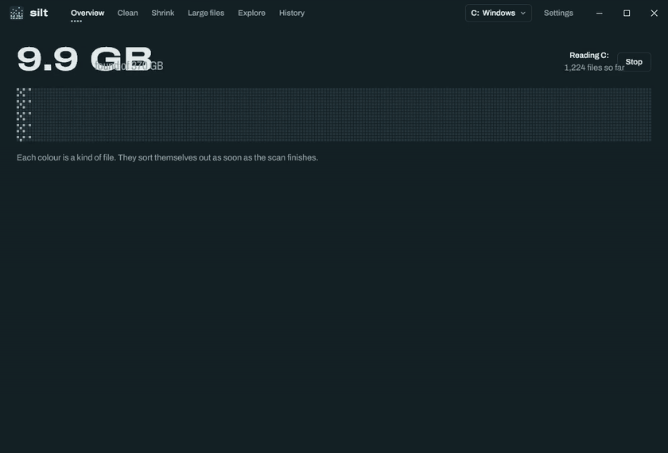
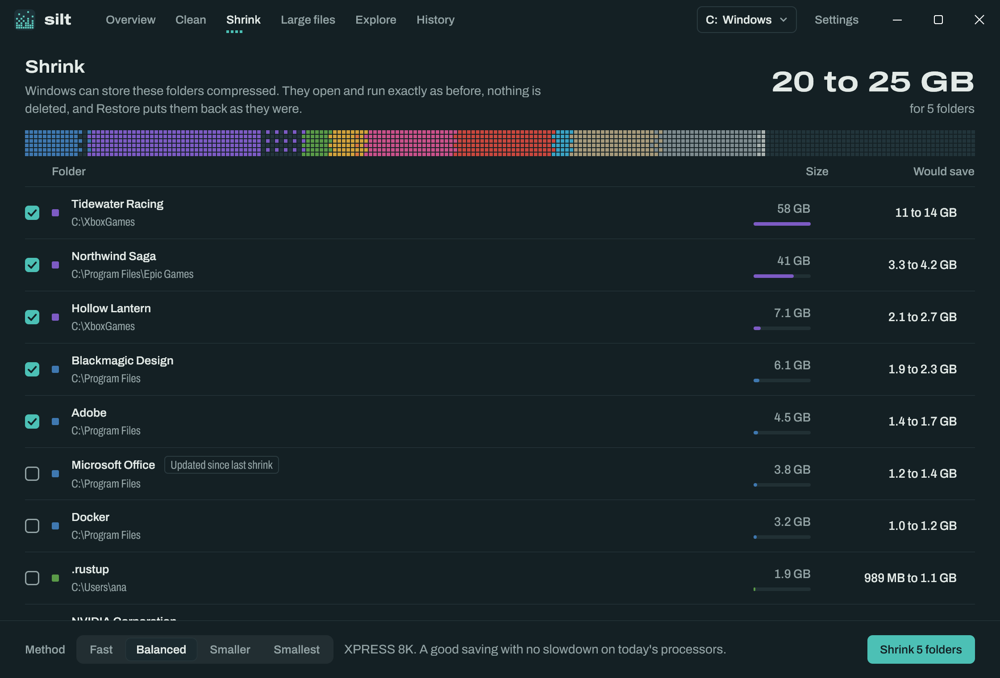

<p align="center"></p>

<p align="center">Veja o que enche seu disco no Windows e recupere o espaço sem apagar o que você usa.</p>

<p align="center"><a href="README.md">English</a></p>

<p align="center"></p>

O Silt lê a MFT (o índice do NTFS) para varrer um disco em um ou dois segundos, separa cada byte
em categorias e oferece quatro jeitos de recuperar espaço, do menos ao mais destrutivo:

| Ação | O que faz | Desfazer |
|---|---|---|
| **Shrink** (encolher) | Compacta pastas com a compressão transparente do próprio Windows (a mesma do `compact /exe`). Os arquivos abrem como antes, só ocupam menos. | Restore, quando quiser |
| **Clean** (limpar) | Esvazia caches que se reconstroem sozinhos (navegadores, shaders de GPU, gerenciadores de pacote, downloads do Windows Update), depois de mostrar o quê e quanto. | O cache volta sozinho |
| **Trash** (lixeira) | Manda para a Lixeira qualquer arquivo ou pasta que você escolher. | A Lixeira |
| **Esvaziar a Lixeira** | Esvazia, depois de mostrar quantos itens e quanto ocupam. | Nenhum |

Todo analisador termina em "isso é grande, apague". O Silt também responde o que fazer quando o
que sobrou é coisa que você usa: a tela inicial mostra quanto dá para recuperar no total e quanto
disso **sem apagar nada**.

<p align="center"></p>

## Instalar

- **Instalador:** `Silt-Setup-<versão>.exe` em [Releases](https://github.com/bps2414/silt/releases).
  Instala só para o seu usuário, sem precisar de administrador para instalar.
- **Portátil:** `Silt-<versão>-portable.zip`, descompacte onde quiser e rode `silt.exe`.
- **winget** (quando o pacote for aceito): `winget install bps2414.Silt`

Windows 10 ou 11, x64. Ao abrir, o Silt pede administrador para ler o índice do disco; se você
negar, ele funciona do mesmo jeito abrindo pasta por pasta (mais lento, e algumas pastas ficam
fechadas para ele). Em Settings, "Ask for administrator" desliga a pergunta.

## É seguro?

O Silt só mexe nos seus arquivos quando você aperta um botão e confirma. Exatamente o que cada
ação faz:

**Clean apaga o conteúdo destas pastas, e nada mais:**

| Grupo | Caches |
|---|---|
| Windows | Arquivos temporários (`%TEMP%`), temporários do Windows (`%WINDIR%\Temp`), despejos de falha e relatórios de erro, cache de miniaturas, cache da Otimização de Entrega, downloads do Windows Update* |
| Navegadores | Pastas de cache do Chrome, Edge, Brave e Firefox (só o cache: nunca histórico, senhas, cookies ou favoritos) |
| GPU | Caches de shader da NVIDIA*, AMD*, Intel* e DirectX* |
| Desenvolvimento | Caches do npm, Yarn, Bun, uv, pip, registro do Cargo, Gradle, NuGet HTTP, build do Go, Electron/node-gyp e VS Code; store do pnpm*, pacotes NuGet*, módulos Go*, repositório Maven*, navegadores do Playwright*, modelos do Hugging Face* |

\* marcados "Check first" e desmarcados por padrão: voltam, mas só depois de um download ou de
uma primeira execução mais lenta (um jogo recompilando shaders, um gerenciador de pacotes
baixando de novo).

As regras são TOML simples em [`rules/`](rules), um arquivo por grupo. Cada uma aponta para a
pasta primeiro por variável de ambiente (assim caches realocados são encontrados) e depois pelo
lugar de costume.

**O Clean nunca:**

- apaga a pasta em si, só o que está dentro;
- segue uma junção ou link simbólico, nem apaga um;
- apaga arquivo aberto por outro programa (ele é pulado e contado);
- mexe na raiz de um disco, em `Users` ou em qualquer pasta de perfil, nos seus Documentos,
  Área de Trabalho, Downloads, Imagens, Vídeos, Músicas ou OneDrive, em `Windows`, `System32`,
  `SysWOW64`, `WinSxS`, `Program Files`, `Program Files (x86)` ou `ProgramData`, nem em pasta
  que contenha uma delas. Essas travas estão no código, não nas regras, então uma regra errada
  não passa por elas.

O "liberado" mostrado depois de um Clean é medido no disco depois, não estimado.

**O Shrink não apaga nada.** Ele pede ao Windows para guardar os arquivos compactados (WOF, o
mesmo que o `compact /c /exe` faz). Os programas leem como antes. Ficam de fora vídeo, imagem,
áudio, arquivos compactados, pacotes de jogo, bancos de dados, imagens de disco, arquivos abaixo
de 4 KB, criptografados, de nuvem e já compactados, a pasta `Windows` e pastas de anti-cheat (a
lista completa é [`rules/shrink-exclude.toml`](rules/shrink-exclude.toml)). Ele exige uma folga
de espaço livre e não começa sem ela. O Restore desfaz, pela tela Shrink ou pelo History.

**Trash** move o que você escolher para a Lixeira, de onde dá para recuperar. Arquivos de sistema
e as pastas protegidas acima nunca ganham o botão. Não existe "apagar para sempre" para arquivo
seu: o único caminho para fora da Lixeira é **Esvaziar a Lixeira**, que pergunta antes.

Toda ação fica registrada em `%LOCALAPPDATA%\Silt\journal.jsonl`, mostrado no History. O Silt não
manda nada pela rede.

## Medido

**Varredura** (MFT, administrador), na máquina do autor:

| Disco | Entradas | Tempo | Memória de pico | Bytes varridos x espaço usado |
|---|---|---|---|---|
| C: (151 GB usados) | 790 mil | 1,2 s | 151 MB | 99,98 % (34 MB de metadados do sistema de arquivos) |
| D: (177 GB usados) | 1,17 milhão | 8,9 s | 208 MB | 99,99 % |

A janela, no mesmo C:, mostra as categorias 1,5 s depois de abrir, e a estimativa do Shrink das
72 pastas candidatas chega cerca de 1,3 s depois. Um disco inventado com 2 milhões de arquivos
chega a 280 MB de pico. Quando nada se mexe, a janela não desenha nada.

**Shrink** (XPRESS8K, o padrão): primeiro a estimativa, depois compactado, conferido e
restaurado. Todos os arquivos foram lidos idênticos byte a byte depois de compactar e depois de
restaurar.

| Pasta | Arquivos | Tamanho | Estimativa | Economia | Erro da estimativa |
|---|---|---|---|---|---|
| `node_modules` de um jogo Vite + React | 3.231 | 359 MB | 114 a 143 MB | 128 MB (36 %) | 0 % |
| Toolchain do Rust 1.99.1 | 132 | 627 MB | 329 a 398 MB | 352 MB (56 %) | 3 % |
| Um jogo do Xbox para PC | 324 | 5,1 GB | 2,3 a 3,0 GB | 2,9 GB (56 %) | 8 % |
| Git for Windows | 3.343 | 396 MB | 177 a 207 MB | 196 MB (50 %) | 2 % |
| Gravações de tela (MP4) | 0 | 0 B | nada a ganhar | 0 B | |

Vídeo, imagem, áudio e arquivos compactados já vêm comprimidos, então o Shrink não mexe neles.

## A CLI

O `silt-cli` faz tudo o que a janela faz, em texto ou JSON:

```
cargo build --release -p silt-cli
target\release\silt-cli report C:          # categorias e o que dá para recuperar
target\release\silt-cli largest C: --min-size 1GB
target\release\silt-cli estimate "C:\Program Files\Git"
```

Comandos que mudam arquivos (`shrink`, `restore`, `clean`, `trash`, `empty-bin`) só mostram o
que fariam até você acrescentar `--yes`.

## Compilar

Rust 1.99.1 (fixado em `rust-toolchain.toml`), Windows x64:

```
cargo build --release --workspace
target\release\silt.exe
```

A janela é feita com [Rune](https://github.com/anomalyco/rune). `silt.exe --snap out.png --scene
shrink` desenha qualquer tela sem abrir janela (`--list-scenes` lista as cenas), num disco
inventado. Veja o [CONTRIBUTING.md](CONTRIBUTING.md), inclusive como adicionar uma regra de
limpeza.

## Licença

MIT ou Apache-2.0, à sua escolha.
